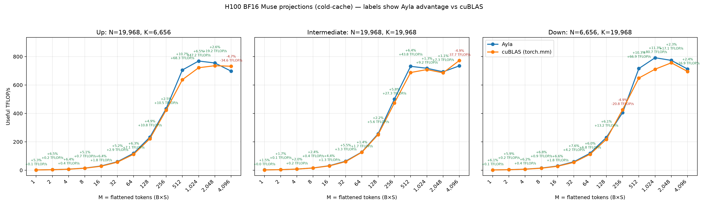

# Muse projection dynamic-M benchmark (H100 GPU 7, cold cache)

The figure contains the three Muse GEMMs:

- Up: `(M, 6,656) @ (6,656, 19,968)`
- Intermediate: `(M, 19,968) @ (19,968, 19,968)`
- Down: `(M, 19,968) @ (19,968, 6,656)`

This checked-in capture was produced from the later `perf/generalization`
research branch. It is included as a historical artifact; the consolidated
benchmark in this PR uses simpler configurations supported by the reviewable
stack.

Each label is Ayla's throughput difference relative to `torch.mm`/cuBLAS:
`100 * (Ayla TFLOP/s / cuBLAS TFLOP/s - 1)` followed by the absolute
TFLOP/s difference. Green is an Ayla advantage and red is a regression.

The final measurements use one GEMM per CUDA graph and stream through a
251,658,240-byte eviction buffer before every timed launch. Each plotted point
is the median of 40 paired, alternating-order measurements. Kernel selection
was performed separately under the same cold-cache protocol using 471 sweep
measurements.

Artifacts:

- Final data: `bf16-muse-dynamic-m-cold-final-h100-gpu7-2026-08-25.csv`
- Tuning sweep: `bf16-muse-dynamic-m-cold-sweep-h100-gpu7-2026-08-25.csv`
- Raster plot: `bf16-muse-dynamic-m-cold-h100-gpu7-2026-08-25.png`
- Vector plot: `bf16-muse-dynamic-m-cold-h100-gpu7-2026-08-25.svg`
