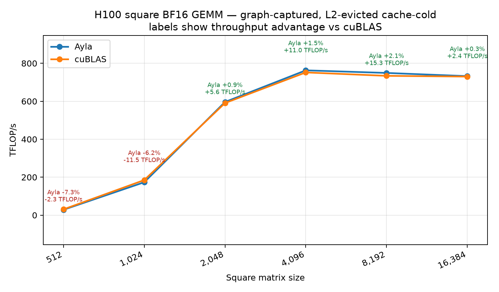

# BF16 square GEMM cold-cache sweep

The sweep compares retained Ayla kernels with `torch.mm`/cuBLAS for every
power-of-two square shape from 512 through 16,384.

This checked-in capture was produced from the later `perf/generalization`
research branch. It is included as a historical artifact; the benchmark script
in this PR uses simpler configurations supported by the reviewable stack.

Each point is one GEMM per CUDA graph replay after streaming through a
251,658,240-byte eviction buffer. The table reports the median of 40
round-robin measurements. Plot labels use throughput advantage relative to
cuBLAS: positive and green is faster; negative and red is slower. The second
line gives the absolute TFLOP/s difference.

| Size | Ayla TFLOP/s | cuBLAS TFLOP/s | Ayla vs cuBLAS |
|---:|---:|---:|---:|
| 512 | 28.53 | 30.78 | -7.31% |
| 1,024 | 173.41 | 184.87 | -6.20% |
| 2,048 | 596.19 | 590.62 | +0.94% |
| 4,096 | 762.87 | 751.85 | +1.47% |
| 8,192 | 749.19 | 733.88 | +2.09% |
| 16,384 | 732.40 | 729.96 | +0.34% |

Artifacts:

- Data: `bf16-square-cold-h100-gpu7-2026-08-25.csv`
- Raster plot: `bf16-square-cold-h100-gpu7-2026-08-25.png`
- Vector plot: `bf16-square-cold-h100-gpu7-2026-08-25.svg`
